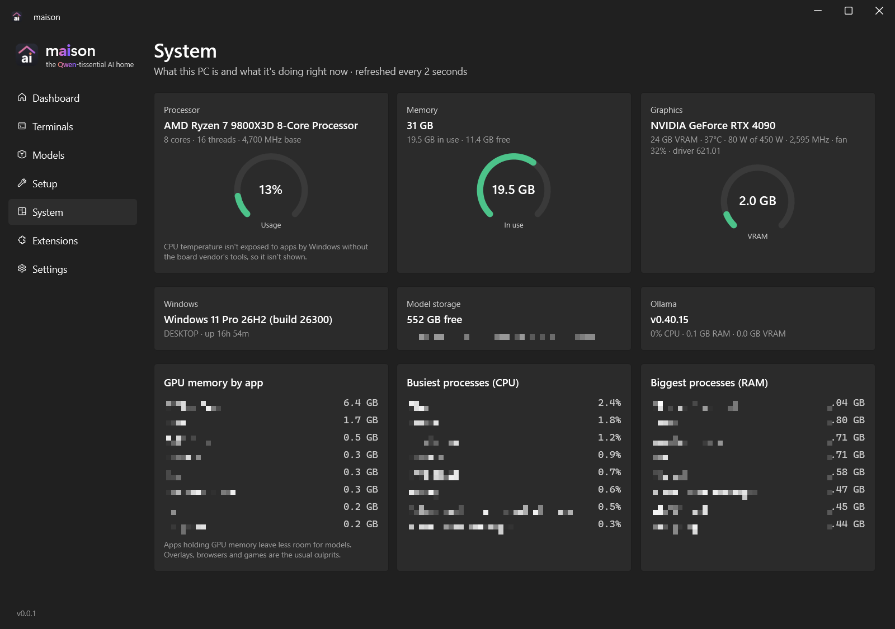
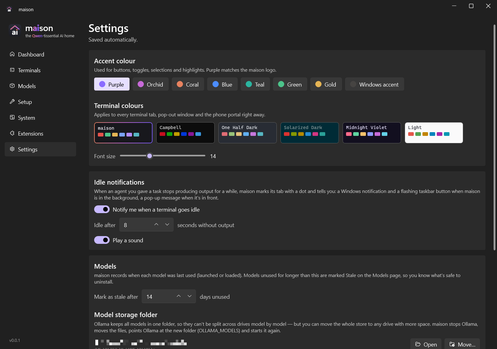

<p align="center">
  <picture>
    <source media="(prefers-color-scheme: light)" srcset="docs/logo-light.png">
    
  </picture>
</p>

**maison** is a Windows app that sets up and runs AI models on your own GPU with [Ollama](https://ollama.com), and launches
**Claude Code** or **Qwen Code** against them. It needs no API keys and makes no cloud calls, so everything stays at home.


## Install

### What you need
- **Windows 10 or 11, 64-bit.**
- **A graphics card with plenty of memory.** An NVIDIA GPU is recommended, and the GPU gauges only work on NVIDIA.
  maison picks a model that fits your card:

  | GPU memory (VRAM) | Model maison installs | Download |
  |---|---|---|
  | 24 GB (e.g. RTX 3090 / 4090) | qwen3.8:27b | ~18 GB |
  | 10–16 GB | qwen3.5:9b | ~6.6 GB |
  | 6–8 GB | qwen3.5:4b | ~3.3 GB |
  | No GPU / under 6 GB | qwen3.5:4b or 2b on the CPU | ~3 GB (slow) |

- **Free disk space:** about 2 GB for the tools, plus the model.
- **Internet**, for the first setup only. After that everything runs offline on your PC.
- No accounts, API keys or subscriptions.

### 1. Download
Go to the [latest release](https://github.com/GreggsNBacon/qwen-maison/releases/latest) and download **`maison-<version>.exe`** (e.g. `maison-0.0.5.exe`; the file name says which version it is).
It's a single self-contained file (no .NET install needed), so you can put it anywhere, e.g. your Desktop or `C:\Tools`.

### 2. Run it
Double-click `maison-<version>.exe`. The exe isn't code-signed, so Windows SmartScreen may say **"Windows protected your PC"**.
Click **More info**, then **Run anyway**. This happens only the first time.

> To check the download, compare its hash with the SHA-256 in the release notes:
> `Get-FileHash .\maison-0.0.5.exe` in PowerShell.

### 3. Press Start
On a new PC maison opens in the **simple view**. Press **Start** and it installs everything, showing each step as it goes:

1. **Ollama**, the engine that runs AI models (official installer, about 1.6 GB, no admin needed).
2. **A Qwen model** sized for your GPU (the big download, see the table above).
3. **Claude Code** (Anthropic's official installer).
4. **Node.js LTS** through winget. Windows asks for permission once, so click **Yes**.
5. **Qwen Code** (`npm install -g @qwen-code/qwen-code`).

Steps already done on your PC are skipped. If one fails, press **Try again**, or **Show details** to see the installer output.

### 4. Use it
When it's ready you'll see a ✓ **Qwen is ready** and a Qwen Code terminal. Type what you want it to do.
- **Change folder** picks the project Qwen works in.
- Turn on **Advanced** (top right) for the full app: Claude Code, models, tabs, system stats, extensions, settings and the phone portal.

Windows may ask whether maison can use the network. That's only needed for the optional phone portal; allow **Private networks** if you plan to use it.

### Updating
Download the newer `maison-<version>.exe` from [Releases](https://github.com/GreggsNBacon/qwen-maison/releases) and delete the old one
(update any desktop shortcut, or recreate it from Advanced → Dashboard).
Your settings and models are kept.

### Uninstalling
1. *(Optional)* In **Advanced → Setup**, use **Uninstall** on the parts you no longer want (Ollama, Claude Code, Node.js, Qwen Code).
2. Delete the `maison-<version>.exe` file, and the settings folder `%APPDATA%\Maison` if you want them gone too.
3. Models live in Ollama's folder (`%USERPROFILE%\.ollama\models` unless you moved it in Settings). Uninstalling Ollama
   doesn't always delete them, so remove that folder to get the disk space back.

### Build from source
You'll need the [.NET 10 SDK](https://dotnet.microsoft.com/download) on Windows.
```powershell
git clone https://github.com/GreggsNBacon/qwen-maison.git
cd qwen-maison\src
dotnet publish -c Release -o ..\dist
..\dist\maison-0.0.5.exe   # publish names the exe after <Version> in Maison.csproj
```
Settings live in `%APPDATA%\Maison\config.json`. Settings from the older "Qwen Local Launcher" build are migrated automatically.

## Pages

**Dashboard**
- Cards: Ollama server status, the loaded model (with % on GPU and context size), and the last speed test.
- GPU gauges, refreshed every 2 s: temperature (green, then amber at 75 °C, then red at 85 °C), load, power against the
  card's limit, VRAM, fan speed and core clock (NVIDIA via `nvidia-smi`).
- Health checks: Ollama install, runtime files (`llama-server.exe`, which catches a broken auto-update), server, loaded
  models with CPU-spill warnings, installed models, and the `claude`/`qwen` CLIs. Refreshes every 10 s.
- Actions: Start, Restart, Speed test, Unload, Repair Ollama (bundled script), and Remove old aliases.
- Machine gauges: GPU temperature, load, power, VRAM, plus CPU and RAM. While a model is loaded, the bright part of each
  gauge is what the AI (Ollama and its model runner) is using and the dim part is everything else; AI power is estimated
  from its share of the GPU's work. A warning appears when another app (an overlay, a
  browser, a game) holds GPU memory the model needs. Without that room, Windows quietly moves part of the model to system RAM and
  generation drops from about 35 tokens/s to almost nothing.
- Launch **Claude Code**, **Qwen Code** or **Chat**. **Open in** chooses where: this app (a tab), Windows Terminal, or a PowerShell window.
  - Claude Code gets a per-session `ANTHROPIC_BASE_URL=http://127.0.0.1:11434` and `ANTHROPIC_AUTH_TOKEN=ollama`, with every
    model slot mapped to the local model. Ollama serves the Anthropic Messages API natively, and your normal `claude` is untouched.
  - Qwen Code runs `qwen --auth-type openai --openai-base-url http://127.0.0.1:11434/v1 ...`.
- **Permissions**: Ask each time, Accept edits, Plan only, or Skip all prompts. maison always passes an explicit mode
  (`claude --permission-mode …`, `qwen --approval-mode …`). Claude Code's *auto* mode isn't offered because its safety
  check runs on Anthropic's servers, which aren't reachable through Ollama ("Auto mode can't check actions in this session").
- Context-window picker. The default is 64K, set by creating a settings-only `<model>-ctx64k` variant.
- **No surprise token limits.** Claude Code and Qwen Code assume a 200K window for models they don't know, so on a 32K/64K
  local model they used to run until Ollama's window overflowed and the request failed. maison tells each agent the real
  window (`CLAUDE_CODE_MAX_CONTEXT_TOKENS`; for Qwen Code a per-session settings file via `QWEN_CODE_SYSTEM_SETTINGS_PATH`,
  so `~/.qwen/settings.json` is untouched) and caps replies at a quarter of it, so they compact the conversation in time.
- Copyable start commands for the current selection.

**Terminals**: Claude Code, Qwen Code, Chat and plain PowerShell sessions in tabs inside the app.


- Each tab is a real Windows pseudo console (ConPTY) shown by xterm.js (WebGL renderer) in WebView2. Full-screen TUIs
  work as they do in Windows Terminal. Output is sent in whole frames (held while a redraw is unfinished: a synchronized-output
  block, a screen clear and reprint, or a repaint with the cursor hidden), so Claude Code and Qwen Code redraws don't jitter.
- A strip above the tabs shows live GPU, temperature, VRAM, CPU, RAM and Ollama usage.
- **Ctrl+V** (or Shift+Insert, or right-click with nothing selected) pastes once. Select text, then right-click or press Ctrl+Shift+C, to copy.
- **Idle indicator**: once an agent you gave a task stops producing output, its tab gets a dot and you're told. A Windows
  notification and a flashing taskbar button appear if maison is in the background, a pop-up if it's in front.
- **Pop out** opens a second window that *mirrors* the same session live: the same process and the same screen, and you can type in
  either. The window you type in sets the size, and other mirrors scale to fit. Closing the pop-out keeps the session.

**Models**
- Install any Ollama model by name, with live progress (size, speed, time left) and Cancel. Interrupted downloads resume.
- Installed list with size, parameter count, quantization, capabilities, age and **last used**. **Use** sets a model as the main model,
  and **Delete** removes it along with its context variants, so the disk space is actually freed.
- **Stale** badge: models not launched or loaded for 14 days (adjustable in Settings) are marked, so you can see what's safe to uninstall.
- A curated Qwen catalog showing whether each model fits your GPU, with a ★ on the recommended pick and a warning when disk space is low.

**Setup**: **Set up everything** installs whatever is missing:
1. Ollama: the official `OllamaSetup.exe` (about 1.6 GB), installed silently for the current user, after which the server starts.
2. The recommended Qwen model for the GPU: qwen3.8:27b for 24 GB, qwen3.5:9b for 10–16 GB, qwen3.5:4b for 6–8 GB, and 4b or 2b on CPU.
3. Claude Code: `irm https://claude.ai/install.ps1 | iex`.
4. Node.js LTS: winget (asks for admin once).
5. Qwen Code: `npm install -g @qwen-code/qwen-code`.

Each step also has **Uninstall** (Stop for the server), so any part can be removed and set up again. **Reinstall everything**
reinstalls the latest Ollama, Claude Code, Node.js and Qwen Code over the top. Models, settings and history are kept.

**System**: CPU (name, cores and threads, usage), memory, GPU (temperature, power, clocks, driver), Windows version and uptime,
model-drive space, Ollama's own CPU/RAM/VRAM use, GPU memory per app, and the busiest processes by CPU and RAM. CPU
temperature isn't shown because Windows doesn't expose it to apps without the board vendor's tools.

**Extensions**: a manager for Qwen Code extensions. Qwen Code installs Claude Code marketplace plugins (converting them
automatically), Gemini CLI extensions, npm packages and git repos.
- Built-in marketplaces: [anthropics/claude-plugins-official](https://github.com/anthropics/claude-plugins-official),
  [anthropics/skills](https://github.com/anthropics/skills) and [anthropics/claude-code](https://github.com/anthropics/claude-code)
  (demo plugins). You can add any Claude-format marketplace by `owner/repo`.
- There's a link to the [Gemini CLI extension gallery](https://geminicli.com/extensions/); install any extension from it by its GitHub URL.
- Installs, updates and uninstalls run in a terminal tab, so you can review and confirm them.

**Settings**
- Accent colour (purple by default, to match the logo) and terminal colour themes: maison, Campbell, One Half Dark,
  Solarized Dark, Midnight Violet and Light. Also the terminal font size.
- Idle notifications: on or off, the number of seconds, and the sound.
- **Start commands**: everything that goes into the Claude Code, Qwen Code and Chat commands as toggles and fields, with a
  live preview of the exact command: telling the agent the real context window, max reply length, when to compact,
  `--continue`, thinking on/off, Qwen Code's request timeout, telemetry and caching switches, plus extra arguments and
  environment variables. **Reset to defaults** puts it all back.
- Stale threshold.
- **Model storage folder**: moves the whole Ollama model store to another drive and points `OLLAMA_MODELS` at it. Ollama
  keeps all models in one folder, so the location is per PC, not per model.
- **Web portal**, below.

**Simple view**: for people who don't want the technical side. New installs start here, and the **Advanced** toggle
(top right) or **Simple view** in the sidebar switches between the two. Sessions keep running when you switch.
- Before setup it shows one **Start** button. Setup runs the same real steps as the Setup page. Each step gets a friendly
  headline ("Moving Qwen in — this is the big download…") with the actual action, progress and latest installer output under it.
  If a step fails, you get **Try again** or **Show details**.
- Once ready it shows one ✓ "Qwen is ready", four plain stats (graphics card, AI memory, processor, memory), a warning if
  another app is slowing Qwen down, and a Qwen Code terminal. That terminal is the same session as the one in Terminals.

| System | Settings | Phone portal |
|---|---|---|
|  |  |  |

### Web portal (phone access)
Open maison in your phone's browser to see the PC's stats and health, start sessions, and use the **same** terminal
sessions as the app. They're mirrors, not copies, and phone pages add a key bar with Esc, Tab, Ctrl+C, the arrow keys and Paste.

1. In **Settings → Web portal**, set a password (at least 8 characters) and turn the portal on.
2. Windows may ask once whether maison can use the network. Allow **Private networks**.
3. On your phone (same Wi-Fi), open one of the addresses shown, such as `https://192.168.1.20:<port>`. Your browser will warn that
   the certificate isn't trusted, because maison made it itself on this PC. Check that the fingerprint matches the one in Settings, then continue.
4. Sign in once. That device stays signed in, and you can sign devices out from Settings.

Security:
- **Encryption**: HTTPS only, with a self-signed certificate kept in your Windows certificate store.
- **Password**: stored only as a salted PBKDF2-SHA256 hash (600,000 rounds). Changing it signs every device out.
- **Remembered devices**: a random 256-bit token in an `HttpOnly; Secure; SameSite=Strict` cookie. Only its SHA-256 hash is stored.
- **Brute-force limits**: 5 wrong passwords lock that address out for 15 minutes, with a global cap of 30 failures an hour.
- **Cross-site protection**: Origin checks on every change and on terminal WebSockets, and a strict Content-Security-Policy.
- **Home network only by default**: connections from the internet are refused (LAN, plus VPN ranges such as Tailscale's 100.64/10).
  You *can* allow them for router port-forwarding, but a VPN such as Tailscale is the safer way to reach maison from outside.
- **Unique port**: picked at random on first run, and changeable.

Every button and control has a tooltip.

## Troubleshooting: Qwen (or Claude) via Ollama is extremely slow or never finishes
Look at **System → GPU memory by app**. If another app holds several GB of VRAM while a model is loaded, the model no
longer fits and Windows moves part of it into system RAM. Generation then drops to single-digit tokens/s (seen here:
NVIDIA App's overlay holding 6.4 GB next to a 21.6 GB model). Close the app, or turn off its overlay or instant replay, or
pick a smaller context (32K) on the Dashboard. maison shows a warning when this happens.

## Project layout
| Path | |
|---|---|
| `src/Services/OllamaClient.cs` | Ollama REST API (version, tags, ps, create, pull with progress, generate, delete) |
| `src/Services/SystemProbe.cs` | Install/runtime checks, nvidia-smi, fresh PATH lookup, start/stop/repair |
| `src/Services/Installer.cs` | Fresh-PC installers (Ollama, Claude Code, Node.js, Qwen Code) |
| `src/Services/ModelCatalog.cs` | Curated Qwen models, VRAM fit estimate, per-PC recommendation |
| `src/Services/Launcher.cs` | Per-session environment and commands; external terminal launch |
| `src/Services/PseudoConsole.cs` | ConPTY wrapper |
| `src/Services/TerminalHub.cs` | Shared sessions: process, history, frame batching, idle detection, size control |
| `src/Services/TermLink.cs`, `TerminalPage.cs` | One viewer ↔ session protocol; the xterm.js page (app and portal) |
| `src/Services/StatsService.cs`, `HealthAdvice.cs` | CPU/RAM/GPU and per-app VRAM polling; the VRAM-crowding warning |
| `src/Services/WebPortal.cs`, `PortalSecurity.cs` | Phone portal (Kestrel HTTPS + WebSockets), auth, cert |
| `src/Services/QwenExtensions.cs`, `ModelStorage.cs` | Extension marketplaces; moving the model store |
| `src/Controls/TerminalViewer.cs` | A WebView2 view onto a shared session (tabs and pop-outs) |
| `src/Controls/ArcGauge.cs` | Animated arc gauge |
| `src/Views/` | Models, Setup and Terminals pages |
| `src/MainWindow.xaml(.cs)` | Shell, sidebar and Dashboard (WPF-UI 4.3) |
| `src/Assets/terminal/` | xterm.js 6.0 + addons (MIT), embedded |
| `src/Assets/brand/` | App icon (`maison.ico`, all sizes) and logos |
| `branding/` | Logo source (`maison-icon.svg`), `make-assets.ps1` to regenerate the icon and logos, and the design explorations |

## Brand
- Name: **maison**, French for "house", with the pun on **ai**. Always lowercase, with *ai* in the gradient.
- Tagline: "the **Qwen**-tissential AI home", with *Qwen* in the gradient.
- Icon: a lowercase *ai* in Segoe UI Variable Display Bold under a gradient roof. The i's dot is coral, like a lit window.
- Gradient: `#E8825F` → `#C76AD8` → `#7C5CFF`.

## Self-test
`maison.exe --selftest <dir> [--pull <model>] [--term <folder>] [--portal <password>]` screenshots every page, writes `selftest.txt` and exits.
- `--pull` installs a model through the Models page and then removes it.
- `--term` opens Claude Code, Qwen Code and PowerShell tabs, then checks:
  - typing through xterm.js reaches the shell;
  - a pop-out mirror shows the same history and its input reaches the shell;
  - Ctrl+V pastes exactly once;
  - Claude Code starts without the auto-mode warning.
- `--portal` runs the web portal over real HTTPS and checks login, cookies, lockout, origin checks, state, launching and the
  mirrored terminal WebSocket. Set `MAISON_CONFIG_DIR` to a scratch folder so your real settings aren't touched.

## Notes
- The exe is unsigned. On another PC, SmartScreen may show "Windows protected your PC": click **More info**, then **Run anyway**.
- The GPU gauges need an NVIDIA card. In-app terminals need the WebView2 Runtime, which ships with Windows 11.

## Legal
- **Unofficial.** maison is an independent project. It isn't affiliated with, endorsed by or sponsored by Anthropic,
  Alibaba Cloud / the Qwen team, Ollama or NVIDIA. "Claude", "Claude Code", "Qwen" and "Ollama" are trademarks of their
  owners. They're used here only to name the tools that maison installs and launches.
- **Nothing is redistributed.** Setup downloads Ollama, Claude Code (Anthropic's official installer), Node.js, Qwen Code
  and models from their official sources. Each one is covered by its own licence and terms, which you agree to when you use it.
- **Claude Code runs unmodified**, exactly as Anthropic publishes it. Your normal `claude` setup is untouched. maison never
  asks for, stores or passes on Claude account credentials. For local sessions it only points Claude Code at your own
  Ollama server (`ANTHROPIC_BASE_URL`), the setup Ollama documents.
- **Third-party code** bundled in the exe (xterm.js, WPF UI, .NET, WebView2) is listed with its licences in
  [THIRD-PARTY-NOTICES.md](THIRD-PARTY-NOTICES.md).
