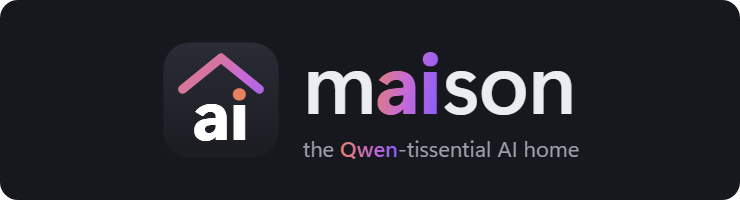
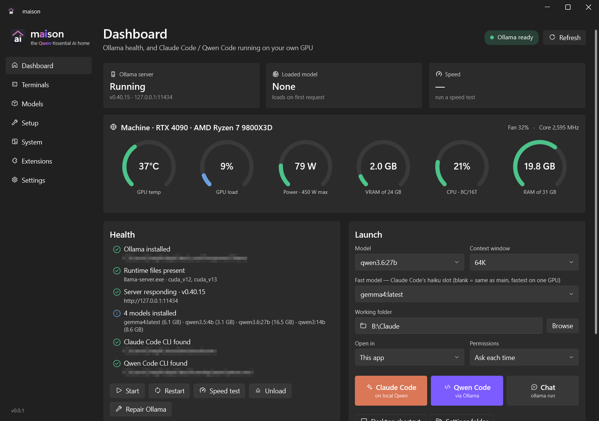
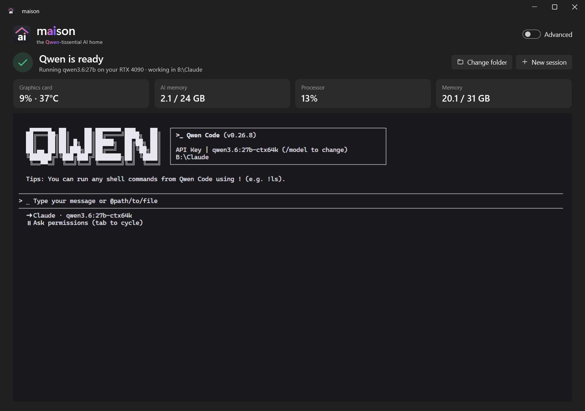
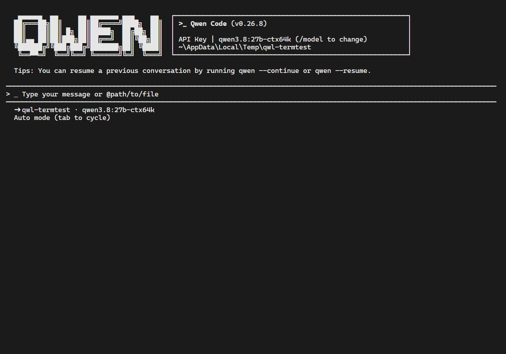
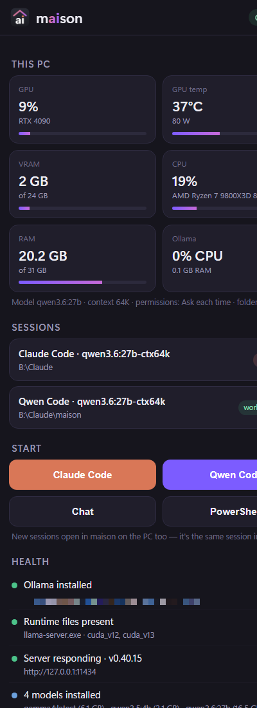

<p align="center">
  <picture>
    <source media="(prefers-color-scheme: light)" srcset="docs/logo-light.png">
    
  </picture>
</p>

**Run a capable AI coding assistant on your own PC, for free, with one click.**

maison sets up [Ollama](https://ollama.com) and a Qwen model sized for your graphics card, then runs **Qwen Code** or
**Claude Code** on it. No accounts, no API keys, no subscription, and nothing you type leaves your computer.



## What it does for you

- **One button to get started.** Press **Start** and maison installs everything it needs, picks the right model for your
  GPU and opens a ready-to-use Qwen terminal. It tells you what it's doing at every step, and skips anything you already have.
- **Private and free.** The AI runs on your own graphics card. After setup it works offline, with no usage limits and
  no per-token bills.
- **Claude Code and Qwen Code, locally.** Use the coding agents you know against your own model. Your normal Claude Code
  setup isn't touched.
- **No "out of tokens" surprises.** maison tells each agent how much the local model can really hold, so long sessions
  are summarised in time instead of failing halfway.
- **Terminals built in.** Agents run in tabs inside the app, without flicker. Pop a session out into its own window, and
  get a notification when an agent finishes and is waiting for you.
- **See what your PC is doing.** Live gauges for the GPU, memory, CPU and power show how much of each the AI is using.
  If another app is hogging graphics memory and slowing the AI down, maison warns you and shows which app it is.
- **Models made easy.** Browse models that fit your GPU, install them with a progress bar, and see which ones you
  haven't used in a while so you can free up disk space. You can even move all models to a bigger drive.
- **An AI pool for the whole house.** Run models on the PCs with the best graphics cards and use them from your laptop or
  other PCs. maison finds them on its own, sends work to whichever is free, and lets you manage their models from one page.
- **Use it from your phone.** Check on a long task, or type to the agent, from your phone's browser on your home Wi-Fi.
  It's password-protected and encrypted.
- **Simple or advanced.** New users get a calm view with one button and one terminal. Flip **Advanced** for the full
  controls: model and context choice, permissions, start-command options, extensions, colours and more.

| Simple view | Terminals | Phone |
|---|---|---|
|  |  |  |

## Install

### What you need
- **Windows 10 or 11, 64-bit.**
- **A graphics card with plenty of memory.** NVIDIA is recommended (the GPU gauges need it). maison picks a model that
  fits your card:

  | GPU memory (VRAM) | Model maison installs | Download |
  |---|---|---|
  | 24 GB (e.g. RTX 3090 / 4090) | qwen3.8:27b | ~18 GB |
  | 10–16 GB | qwen3.5:9b | ~6.6 GB |
  | 6–8 GB | qwen3.5:4b | ~3.3 GB |
  | No GPU / under 6 GB | qwen3.5:4b or 2b on the CPU | ~3 GB (slow) |

- **Free disk space:** about 2 GB for the tools, plus the model.
- **Internet** for the first setup only.

### 1. Download
Download **`maison-<version>.exe`** from the [latest release](https://github.com/GreggsNBacon/qwen-maison/releases/latest).
It's a single file with nothing else to install, so put it wherever you like, e.g. your Desktop.

### 2. Run it
Double-click it. The exe isn't code-signed, so Windows SmartScreen may say **"Windows protected your PC"**: click
**More info**, then **Run anyway**. This happens only the first time.

> To check the download, compare `Get-FileHash .\maison-<version>.exe` (in PowerShell) with the SHA-256 in the release notes.

### 3. Press Start
maison installs, in order:
1. **Ollama**, the engine that runs AI models (about 1.6 GB).
2. **A Qwen model** for your GPU (the big download).
3. **Claude Code**, from Anthropic's official installer.
4. **Node.js**. Windows asks for permission once, so click **Yes**.
5. **Qwen Code**.

If a step fails, press **Try again**, or **Show details** to see what went wrong.

### 4. Use it
When you see ✓ **Qwen is ready**, type what you want done into the terminal. **Change folder** picks the project it
works on. Turn on **Advanced** (top right) for everything else.

Windows may ask whether maison can use the network. That's only needed for phone access; allow **Private networks** if
you want it.

## Using maison

**Simple view.** One terminal, four plain stats (graphics card, AI memory, processor, memory) and a warning if
something is slowing Qwen down. Sessions keep running when you switch views.

**Advanced view:**
- **Dashboard**: health checks with one-click fixes (Start, Restart, Repair Ollama), live gauges, and launch buttons for
  Claude Code, Qwen Code and plain Chat. Choose the model, how much it can keep in mind (context window), the project
  folder, where it opens (a tab, Windows Terminal or PowerShell) and what the agent may do without asking.
- **Terminals**: all sessions in tabs. Paste with Ctrl+V; copy by selecting and right-clicking. A dot on a tab means that
  agent has finished and is waiting.
- **Models**: install, use or delete models; a catalog that shows what fits your GPU; "stale" badges for unused models.
- **Setup**: install, reinstall or uninstall each part separately.
- **System**: detailed CPU, memory and GPU information, and which apps are using graphics memory.
- **Extensions**: add skills and plugins to Qwen Code, including Claude Code plugin marketplaces.
- **Settings**: accent colour, terminal colours and font size, notifications, start-command options, where models are
  stored, and phone access.

Every button has a tooltip explaining what it does.

## Phone access
1. In **Settings → Web portal**, set a password and turn the portal on.
2. On your phone (same Wi-Fi), open one of the addresses shown, e.g. `https://192.168.1.20:<port>`. Your browser will warn
   that the certificate isn't trusted, because maison made it itself. Check that the fingerprint matches the one in
   Settings, then continue.
3. Sign in once; that phone stays signed in until you sign it out in Settings.

You see the same live sessions as on the PC (type on either), plus stats and a key bar with Esc, Tab, Ctrl+C and arrows.

Is it safe? Connections are encrypted, the password is stored only as a strong hash, repeated wrong guesses are locked
out, and by default only devices on your home network (or a VPN like Tailscale) can connect at all.

## The AI pool: use your other PCs' AI
Run the model on the PCs with good graphics cards, and use them from any PC at home: like Claude Code with a model in
the cloud, except the "cloud" is your own PCs. With more than one AI PC, a busy one hands work to a free one.

1. **On each AI PC:** in **Settings → AI pool**, turn on **Share this PC's AI with my other PCs**. Windows asks for
   permission once. maison shows a 6-digit pairing code. Keep maison running there (minimised is fine).
2. **On your other PC:** open the **AI pool** page (or, in the simple view, click **Use its AI instead**). AI PCs at home
   show up by themselves, with no addresses to type. Enter each one's code and press **Add to pool**, then turn on **Use the AI pool**.

The AI pool page shows each AI PC's graphics card and whether it's free or busy, which agents are using it (from which
PC), and its models. You can install or remove models on it, or set the whole PC up (Ollama and a model sized for its
GPU) from where you sit.

Agents work on the files of the PC you're at; only the model's thinking happens on an AI PC. Each session stays on one
AI PC while that PC is free, so replies start quickly, and moves to another if it gets busy or switched off.

Is it safe? Only PCs you've paired with the code can use an AI PC, connections are encrypted, and maison only opens its
ports to your home network (and Tailscale), never the internet. Ollama itself stays private to each PC.
## Troubleshooting

**The AI is extremely slow or never finishes.** Usually another app is using graphics memory the model needs, so Windows
pushes part of the model into normal RAM and it slows to a crawl. maison shows a warning naming the app. Close it (or
turn off its overlay or instant replay; the NVIDIA App's overlay is a common one), or pick a smaller context window on
the Dashboard.

**An AI PC doesn't show up, or shows Offline.** Check that PC is on and awake, that maison is running there with sharing
turned on, and that both PCs are on the same network. Windows must treat that network as Private; maison offers to set
this when you turn sharing on. On another network (e.g. Tailscale), add it by name under **Not listed?** on the AI pool page.

**Something isn't installed or won't start.** The Dashboard's health checks say what's wrong. **Repair Ollama** fixes a
broken Ollama update, and **Setup** can reinstall any part.

## Updating and uninstalling
- **Update:** maison checks GitHub for a newer version when it starts and once a day (turn this off, or **Check now**,
  in **Settings → Updates**). When there is one, an **Update to …** button appears in the title bar and opens the download
  page. Download the newer `maison-<version>.exe`, close maison, run the new one and delete the old one (recreate any desktop shortcut with the
  **Desktop shortcut** button). Your settings and models are kept.
- **Uninstall:** optionally use **Uninstall** on the parts you don't want in **Advanced → Setup**, then delete the exe
  and the settings folder `%APPDATA%\Maison`. Models live in `%USERPROFILE%\.ollama\models` (unless you moved them);
  delete that folder to get the disk space back.

## Build it yourself
With the [.NET 10 SDK](https://dotnet.microsoft.com/download) installed:
```powershell
git clone https://github.com/GreggsNBacon/qwen-maison.git
cd qwen-maison
.\build.ps1
```
That makes `dist\maison-<version>.exe`. Or open the folder in maison and ask Qwen Code to *"build maison and run the
self-test"*: the repository includes instructions for AI agents. Details, testing and how it works:
[docs/DEVELOPING.md](docs/DEVELOPING.md).

## Legal
- **Unofficial.** maison is an independent project. It isn't affiliated with, endorsed by or sponsored by Anthropic,
  Alibaba Cloud / the Qwen team, Ollama or NVIDIA. "Claude", "Claude Code", "Qwen" and "Ollama" are trademarks of their
  owners. They're used here only to name the tools that maison installs and launches.
- **Nothing is redistributed.** Setup downloads Ollama, Claude Code (Anthropic's official installer), Node.js, Qwen Code
  and models from their official sources. Each one is covered by its own licence and terms, which you agree to when you use it.
- **Claude Code runs unmodified**, exactly as Anthropic publishes it. Your normal `claude` setup is untouched. maison never
  asks for, stores or passes on Claude account credentials. For local sessions it only points Claude Code at your own
  Ollama server (`ANTHROPIC_BASE_URL`), the setup Ollama documents.
- **Third-party code** bundled in the exe (xterm.js, WPF UI, .NET, WebView2) is listed with its licences in
  [THIRD-PARTY-NOTICES.md](THIRD-PARTY-NOTICES.md).
